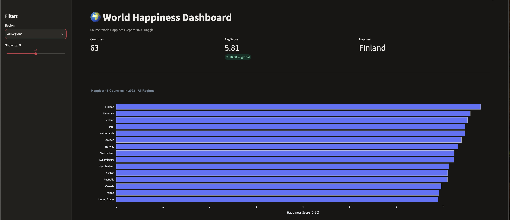
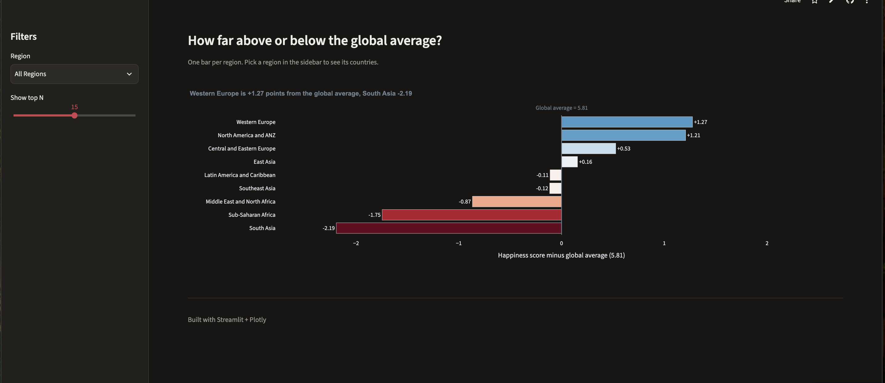
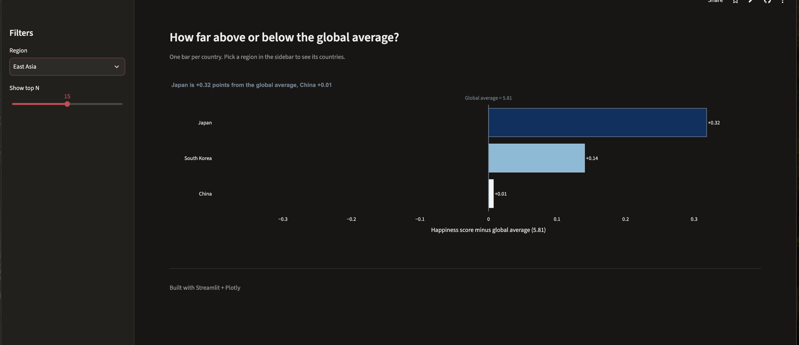

# Lecture 9 — Streamlit Dashboard

**Live app:** https://dataviz-exercises-elifsilaokutucu-week09.streamlit.app

Deployed on Streamlit Community Cloud from this repo (`week09/lecture09_exercise.py`).

## What I added
A **diverging bar chart** showing how far each region's average happiness score is above or below the **global average**:
- `RdBu` diverging scale with `color_continuous_midpoint=0` — blue = above average, red = below, white = the global average
- The midpoint is labelled with an annotation (*Global average = 5.81*)
- Sorted by gap, horizontal bars, values as direct labels
- Linked to the sidebar filter: **All Regions** shows one bar per region; selecting a region drills down to its countries

## Screenshots

**Dashboard overview — KPIs and top-15 bar chart**

**New chart — gap to the global average (all regions)**

**Filter in action — countries of the selected region**
